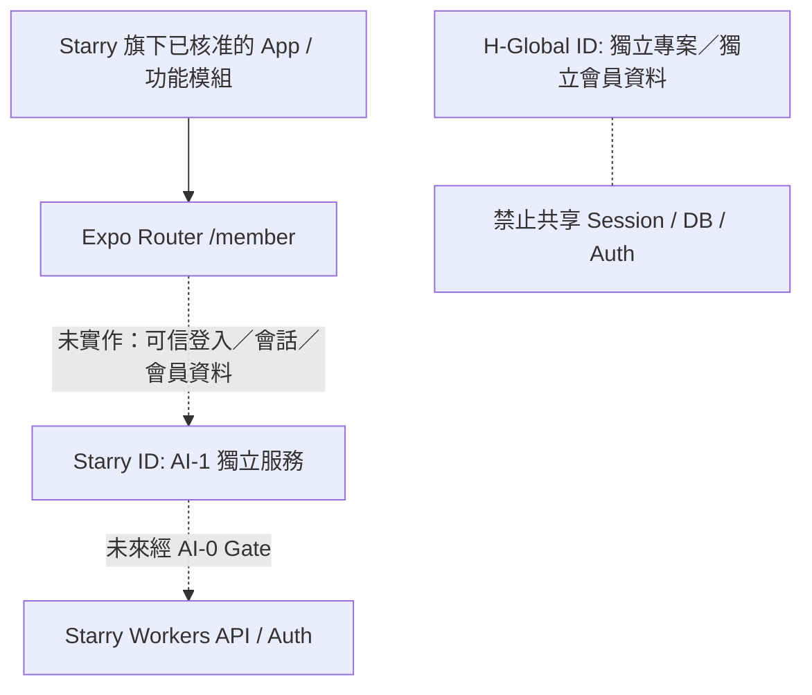

# AI-4｜新版第一輪 Expo / Workers / OpenAPI / SDK / CI 交接
**範圍：** #5，接續 AI-0 Draft #25 SHA `f9c02e2350fc1cf0311574ac05c3536d9b2900f5`；此分支堆疊於 #25，兩 PR 均未合併 main。
**現狀：** 可測試的 Phase0 候選；不含正式 OAuth、D1、上架、付款、Production、H-Global 程式。

## Starry ID 是明確獨立會員入口

- `/member`, `/member/sign-in`, `/member/profile`, `/member/session` 是**明顯標示禁用**的導航和畫面，不是假登入、假會員或公開 API。
- `apps/mobile/src/brand-registry.ts` 是設定驅動的 **Starry-only** 模板與四端範圍，`memberAuthEnabled=false`，`crossBrandSyncEnabled=false`。此時只核准一個 Starry ID 樣板；旗艦產品數量未決，不自行新增十幾個上架 Bundle ID。
- 版本釘選：Node 22、npm lockfile v3、Expo **SDK 54** (lock resolved `expo 54.0.38`)、Expo Router 6、RN 0.81 / RN Web；新增套件務必同步 lock + CI。
- Worker 實際只處理 `GET /v1/health`，development/staging scope fail-closed；沒有任何 live member/billing/audit/admin endpoint。
- OpenAPI 3.1 只標示已實作 health；typed SDK 只支援 liveness。Hono/Zod 的第三方 runtime 僅作 [ADR-AI4-0002](../adr/ADR-AI4-0002-API-POC-20261026.md) 候選。

## 四端最小可驗證策略
| 目標 | 自動驗證（Phase0） | 尚需人工／後續 Gate |
| --- | --- | --- |
| Web | TS/ESLint、Expo config、路由定義及 lock install | 實際瀏覽器煙霧／E2E |
| PWA | 同 Web 的 Expo config + route metadata | manifest、安裝性、離線策略 |
| iOS | Expo config + strict TS | iOS simulator/device + EAS sandbox build |
| Android | Expo config + strict TS | Android emulator/device + EAS sandbox build |
**注意**：上述 CI **不等於已跑四端真機**，也不等於完成 App Store / Google Play 政策驗證。任何 EAS/部署由獨立 Gate 授權。

## 未來雲端單一受控工作樹設計（僅提案，尚未選商／開通）
- 單一 Monorepo Starry 工作樹，依目錄 CODEOWNERS 的五角色責任；讀者可平行、但正式 Git 寫入集中於一位受控提交者。
- 每次集中寫入者先核對 HEAD/來源 SHA，採每組隔離分支或 worktree、pin contract、完整 `npm ci && npm run typecheck && npm run lint && npm test`，再在 GitHub 開 Draft PR／要求 AI-0 Gate。
- 單一短效最小權限權杖；Protected main、PR/CI、簽核與 rollback 保留；對 GitHub REST 保守限流、避免重複推送與無界輪詢。
- 雲端平台／費用／權限與 cutover 日期尚待業主另案決定；**本 PR 不會建置雲端工作站**、不開通付費、也不改五組目前協作模式。

## 指令
```sh
npm ci --no-audit --no-fund
npm run typecheck
npm run lint
npm test
npm run ssot:validate
npm run mobile:config
npm run api:check   # ONLY wrangler --dry-run
```
**依賴：** #25 SSOT seed 尚需 AI-0 完整盤點，AI-1 尚未在新架構實作真實 Starry Auth/Profile。PR #19～#24 僅歷史參考；不將舊 Gate2 CI 認定為重啟架構通過。
