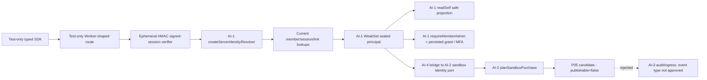

# AI-4｜新版第二輪 secure Worker + SDK + Billing/Audit P05
依據 AI-0 Issue #5 第二輪派工、AI-0 四組單 checkout [PR #30](https://github.com/starry-phd/id/pull/30) SHA `a74f9495c807e77d5fc3dde73f9cc79fb6002e89`。AI-4 本輪在自己的隔離 Draft 分支上，基於 PR #30（堆疊 PR），不覆寫 #25~#30 來源。

## 安全路由切片

- `apps/api/test-support/**` 和 `packages/sdk/test-support/**` 是 **test-only**，不是正式 Worker `apps/api/src/index.ts` 或 SDK `packages/sdk/src/index.ts` 的 export。**正式入口仍只有 `GET /v1/health`**。
- Signed-session `HMAC` 使用測試當下生成 **不可匯出** key，沒有固定 secrets、沒有 OAuth/JWKS/真實 Session store。resolver 每請求查詢當前 active member、Session revoked/version/time、穩定 subject 綁定及 server-owned scope；不接受來自 JSON、`adminVerified` flag 偽造可信身分。
- Protected test routes：`GET /__contract/member/self`、`GET /__contract/admin/check`、`GET /__contract/billing/check`（**僅回傳無副作用 contract proof，不執行會員修改/付款**）。關閉時 HTTP 正式服務全部 404。
- `verifiedBillingIdentity` 僅接受 `isTrustedPrincipal` minted object、server-owned accountBinding；Client 不能提供權益與 binding。
- `docs/contracts/AI4-REBUILD-P05-EVENT-CANDIDATE.md` 說明 canonical event blocked：AI-2 Billing outbox 的 event_type 目前不是 AI-3 approved audit event，proposal 不發送，負向測試拒絕不匹配。禁止拿兩組獨立測試假稱跨模組正式 Queue 測試。
- `npm ci`、root TS/lint/tests、AI-1/2/3 domain TS/Node/SQLite memory、Wrangler **dry-run** 同 SHA CI；不得觸碰 production/Cloudflare、D1/EAS/store/付費或 H-Global。

## 開放阻塞
1. AI-0 Gate0 SSOT `seed_only` 仍阻塞；AI-0 P05 canonical event 尚未核准。
2. AI-1 真 Apple/Google OIDC/JWKS/PKCE / session storage / D1 CAS；本輪只是 test-only signed-session verifier fixture。
3. AI-2 真 Store Server JWS/Google RTDN/Developer API，單一 Billing D1/outbox writer；AI-3 D1/Queue inbox/retention/retry；四端 EAS/Web E2E 未驗。
4. AI-0 決定何時正式暴露任何會員/Auth/管理/付款 API；此 PR 不開啟任何此類正式路由。
