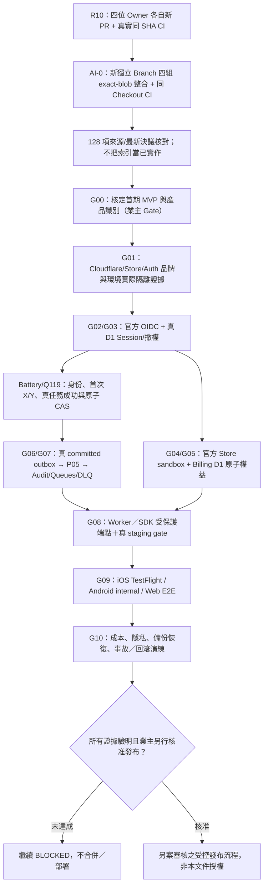

# AI-0｜R10 開發期間平行預備佈局與 R11 工作路線（2026-10-27）

> 狀態：**PREPARATION / NO RELEASE AUTHORIZATION**。本文件為 AI-0 非程式開發線的預先規劃，R10 四位 Owner 正在各自 ChatGPT 對話執行，其結果仍未由本文件驗收。不得將本規劃視為已實作、已核准或已部署。
>
> 固定來源：[Issue #1](https://github.com/starry-phd/id/issues/1)、[R9 verified integration Draft #76](https://github.com/starry-phd/id/pull/76) HEAD `e5a3ba76695316b3eaeb218fb0edd901d8820931`、[optimized SOP #70](https://github.com/starry-phd/id/pull/70)、[11 Release Gate source](../release-readiness/release-readiness.v0.json)、[ADMIN-PREP #13](https://github.com/starry-phd/id/issues/13)、[future Starry admin contract](../contracts/FUTURE-STARRY-ADMIN-API.md)。H-Global 工程暫停。

## 1. 平行工作隔離與重複開發防線

| 工作線 | 現階段正在處理 | AI-0 平行可先做（本規劃） | 不可做 |
| --- | --- | --- | --- |
| AI-1 Auth／會員／權限 | R10 依 [#76](https://github.com/starry-phd/id/pull/76) 繼續的真正 owner code | 整理真 OIDC、Session revoke、Q104/Q119 隱私證據的缺件與 Gate 驗收定義 | 擅改 AI-1 Auth 程式、真登入金鑰 |
| AI-2 Billing／IAP | R10 owner code | 彙總 Official Store Sandbox、SKU、refund/outbox/P05 鏈的證據清單 | 推定 Store/SKU 已核准、開正式付款 |
| AI-3 免費 Battery／稽核／復原 | R10 owner code | 整理 Q116 真備份、跨域反復活、稽核法規、告警/回復演練的驗收責任 | 操作真正 D1/R2/Queue/備份 |
| AI-4 Expo／Workers／SDK | R10 owner code | 梳理 first consumer App、iOS/Android/Web staging/真裝置/EAS Free 的前置核准項 | 啟動 EAS Build、Preview 或 Worker 真部署 |
| AI-0 整合／治理 | 不與四位衝突 | Gate 證據矩陣、R10 同 SHA 整合 checklist、R11 障礙依賴順序、第二波 ADMIN-PREP 證據入口 | 覆蓋四位 PR、合併 main、解除任一 Gate |

**版本原則**：Owner 下一輪 PR 可能比上表更新。真正驗收時由 GitHub 即時讀最新 Issue／PR／固定 SHA；本文件只鎖定「規劃時已驗 R9 base」，不預測 R10 成果。

## 2. R10 到 R11 依賴順序（僅建議，不自動派工）

解讀：這是**依賴圖**，不是要求每個 Gate 必須等所有其他 Gate 完成才能開始研發；G02/G03、G04/G05 和 Q116 的離線工程可平行，但它們**不能**以彼此 mock／green CI 充當生產環境驗收。

## 3. AI-0 現在可提前完成的事情

1. **發布證據對照表**：把 11 個 Gate 對應到應提交的 proof URL、Owner、驗證級別與誰需要授權。另見 [Gate 缺口與決策清單](../release-readiness/AI0-R10-EVIDENCE-AND-DECISIONS-20261027.md)。
2. **固定 R10 驗收規則**：可用一個 AI-0 Git Tree + 1 Commit 匯入四位 Owner 完整內容；逐 PR 核對最終 SHA/blob；排除會覆寫最新 CI 的舊 workflow 檔並明記；一次跑新版全量 Gate，不能借用四組不同 HEAD 的 CI。
3. **上線前的擁有者決策佇列**：未定的第一款 consumer App、Apple/Google 商店識別、真 SKU、Battery X/Y 與費率／透支上限、Q104/Q119 合規、雲端/EAS 成本上限只列為待決，**不代填數值**。
4. **第二波後台無侵入預留審查**：第一波 P01–P10 應以 [ADMIN-PREP Issue #13](https://github.com/starry-phd/id/issues/13) 及 Starry-only 版本化 admin contract 的證據為主；**不啟動** 12×5 capabilities、60 個 API、管理 UI 或 H-Global 服務。
5. **風險登記**：R9 #76 離線 3/3 CI success ≠ 真 OIDC、Store receipt、D1/R2/Queues、PITR、真 EAS／商店成功；舊 `release-readiness.v0.json` 尚引用 R4 作 baseline，是歷史 snapshot，**本規劃不修改原 Gate statuses 或偽造 release evidence**。

## 4. 只由業主或專責合規方決定的項目

| 決策 | 暫定狀態 | 原因與禁止事項 |
| --- | --- | --- |
| 第一款正式 Starry 消費者 App（名稱、App ID、iOS Bundle/Android package、預定市場） | **NOT_SET** | Q105 Starry ID 只是中央服務，不是獨立 Store App；不得替業主創造真商店產品 |
| IAP 商品 SKU、定價、幣別、商店/跨 App 權益及實際帳號環境 | **NOT_APPROVED_FOR_RELEASE** | AI-2 現為 sandbox-only，正式 Apple/Play 必須獨立權威驗證；Battery 禁付費儲值／兌換 |
| Starry Battery 首註贈送 X、首個合法 AI 任務贈送 Y、各 App/task 費率、欠額／單次限額 | **VALUE_PENDING** | 已核準永久免費和產品方向，**數額尚非正式核准**，不可依測試示意上線 |
| Q104 合法同意撤回／跨品牌連結與 Q119 防重發放的個資保留、去識別、刪除權 | **LEGAL_REVIEW_REQUIRED** | Starry/H-Global 雙獨立 Auth/DB/會員，跨品牌同步停用；HMAC 指紋仍可能是個資 |
| Cloudflare/EAS、Store、資料儲存、稽核保留及事故恢復的成本/額度 | **BUDGET_PENDING** | 先提出免費額度內可行性及最差情境，缺可信成本資料不能捏造價格或授權付費 |
| 首期真 staging、OAuth、D1、Store、EAS、Secrets/環境保護及可回復部署 | **EXPLICIT_APPROVAL_REQUIRED** | 必須逐項業主授權；不能由成功的 Draft CI 推導許可 |

**這些是決策佇列，不是要求使用者現在逐題作答。** 除非決策阻塞當下安全開發，AI-0 優先繼續能獨立完成的離線驗收與證據準備。

## 5. 第二波管理中心的分界

- Starry 和 H-Global 的中央管理中心必須**完全獨立後端、權限、資料庫、Secrets、金流、部署與網域**；將來最多共用**非敏感 UI 元件／SDK 形狀**，不共享正式管理 token 或跨品牌寫庫。
- 第一波 P01–P10 只要求**保留安全接入能力並提供證據**；第二波完整 mobile-first React/TypeScript 管理 UI、全部報表、全部 60 capabilities、其他生態系管理面目前尚未啟動。
- 須與「Starry ID 非獨立 Store App」分開：後台 Web/PWA 候選 `admin.starry.phd` 只是提案，並非已核定或上線域名。

## 6. AI-0 驗收與安全報告約束

- 最新 Owner R10 四組 **各有真新 PR + Commit + 同 HEAD CI** → 確認沒有未來版本衝突 → AI-0 以固定 base/來源 SHA 合成 **新 Draft**。
- 僅在新整合 HEAD 下 GitHub Actions **全部 completed/success**，才可標「`R10_OFFLINE_SAME_CHECKOUT_VERIFIED`」；缺驗證時只能標 `AWAITING_CI` 或 `BLOCKED`。
- Release G00～G10 現仍 **11/11 BLOCKED**；不得把離線 TS/Node/SQLite、模擬 D1、Store fake、EAS config、Wrangler dry-run 當作實際上線驗證。
- **安全限制：** 不合併 `main`、不改 production secrets/DB、不部署 Cloudflare、不啟用商店或 EAS 付費、H-Global 持續暫停；跨對話 AI 無法由本文件自動喚醒。

**用途**：四位 AI 目前不需為本規劃停下 R10；此 AI-0 文件可讓後續總驗收與業主討論直接沿用 GitHub，而不是重做前置整理。
