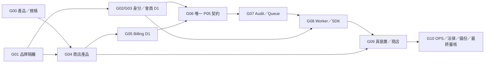

# AI-0｜R16 平行準備：11 項正式發布 Gate 缺口、候選依賴與最少人工作業（2026-10-27）

> **規劃與風險整理，非正式 Release Gate 變更。** 以 GitHub [AI-0 R15 已驗同版整合 #112](https://github.com/starry-phd/id/pull/112) HEAD `e9b4a9e244342bfc2725b1daafca21dbb35ff8ad`、[正式 Gate 機器檔](../release-readiness/release-readiness.v0.json)、[R10 的既有證據缺口分析](../release-readiness/AI0-R10-EVIDENCE-AND-DECISIONS-20261027.md) 與 Issue #1 為來源。**不同輪離線程式、CI 綠燈，都不等於真 Apple／Google／Cloudflare／Store／EAS／法律或業主批准。**
>
> 四位 AI-1～4 正進行 **R16 新的 Auth→Billing/Battery 事件 source/publisher/delivery** 程式。AI-0 此處做不競合的全局阻塞決策排序、真正證據定義和自動防誤判，不更動四個 Owner 分支、不替四位選定實作或使用真環境。

## 一、截至 R15 究竟還沒解鎖什麼

正式 `docs/release-readiness/release-readiness.v0.json` 顯示 **G00～G10 共 11／11 blocked**；各 Gate 的正式 `evidence` 在此固定版為空、`verified_by`／`approval_record_url` 未提供，最後 `release_authorization.granted=false` 與 `deployment_automation.can_auto_deploy=false`。該正式 JSON 的 `baseline` 是原第 4 輪 #46 **歷史基準**，不是現在整合停在 R4；真正最新離線原始碼基準是 R15 #112。不可更新前者日期、Gate、證據來冒稱已驗正式服務。

| Gate | 專責 | 下一步**免真環境**可進行 | 真正能解鎖時欠缺的核可證據 |
| --- | --- | --- | --- |
| G00 SSOT | AI-0 | 排出第一個 Starry App 的 MVP 候選、核對 128 項來源界線 | **業主**逐項核准的 App/用途/產品範圍及規格結論 |
| G01 隔離 | AI-0 | 盤點 Starry/H-Global 預定環境及資源責任人，絕不互讀 | 經核對的真 Cloudflare、Auth/DB/Secrets/金流隔離與拒絕案例 |
| G02 OIDC | AI-1 | 持續 JWKS/PKCE/state/nonce 的離線負測 | 官方 Apple/Google 測試環境、真回呼與憑證輪換 |
| G03 Session/D1 | AI-1 | 刪帳、版本 CAS、Session 撤權/反復活負測 | 真 Starry D1、合法遷移、即時撤權和回復驗證 |
| G04 Store | AI-2 | 商品權益、續訂、退款、重播規格/負測 | 核准商店 ID/SKU 後官方 Sandbox 收據、退款和 Store 伺服器驗證 |
| G05 Billing/D1 | AI-2 | 本地 Billing 權益與 outbox CAS／競態 | 真 Billing D1／Store 權威已提交來源及多 Worker 測試 |
| G06 P05 | AI-0 | 刪帳／付款跨域 Publisher、事件版本與 durable receipt 的候選決策 | 業主核准的 **唯一正式 P05**、權威來源、跨域兼容和實際 committed proof |
| G07 Audit/Queue | AI-3 | Audit、inbox/DLQ、ACK 後提交及隱私遮罩負測 | 真 Cloudflare Queue/D1/DLQ、法律保留與事故回復演練 |
| G08 Worker/SDK | AI-4 | OpenAPI、SDK、權限、Expo 配置及 dry-run | 真受控 Worker API、Secrets 與 Staging/rollback 證據 |
| G09 Devices | AI-4 | 準備 iOS/Android/Web 測試策略與 EAS 成本控制 | 真 TestFlight、Play Internal、Web E2E、原生裝置／商店測試 |
| G10 OPS | AI-0 | 事件應變/成本/稽核/備份計畫及合法保留問題 | **業主**批准成本上限、法遵/刪帳、真獨立 PITR 備份及恢復演練 |

這不是百分比進度表；**只有真證據與有權限審核才能解除任何 Gate**，未提供時一律記 `blocked`，不得藉 CI mock 將其改成 `verified`。

## 二、如何安排：可平行工作的 4 條軌道

- **A. 產品先決（G00）**：整理第一款 Starry App、128 筆核准 MVP、免費電池 X/Y/費率、哪些商品使用官方 Store、使用市場和基本 bundle/package ID。**業主尚未正式裁決數值與產品識別**，這裡只做候選和缺件表。
- **B. 隔離與成本先決（G01/G10）**：只讀列出 Starry 專用 Auth、Billing、Battery、Task、Audit、Staging/prod 身分權限/成本；任何實際 Cloudflare 帳單或官方額度若不可查，明列 `UNKNOWN`，不可捏造零成本。
- **C. 單一來源事件契約（G06/G07）**：四位 R16 執行時，AI-0 釐清只有**一個獲核准的 publisher/translator/inbox receipt**；R15 的 Auth/Battery/Billing/AI-4 不同候選不等於全域原子或正式 P05。不得先啟用真 Queue、Store 或免費電池重贈。
- **D. 真平台驗收設計（G02–G05/G08–G09）**：可事先準備 Apple/Google、D1/Queue、PITR、EAS、真裝置所需受保護測試資料／權限／計費上限；**目前只寫計畫**，不創建雲端資源。

這 4 項 **可在四位 R16 工作期間平行準備**，不能以附屬的「候選驗收排序」限制安全的離線工作。**不要指定預計日期或以 G10 通過前十項代表自動獲准上線。**

## 三、候選的發布前確認順序（不是已核准的部署依賴）

此 Mermaid 是從既有 R10 缺口及正式 Gate 需求**推導的候選審核先後關係**；不等於真服務必須逐條串行開發，也沒有授權使用任何外部平台。對應可機器核對的完整 DAG 在 [候選 critical path JSON](../release-readiness/r16-critical-path.v0.json)。

## 四、真正交付的可執行檢查（不寫任何正式 Gate）

1. [候選 11 Gate × 四軌 machine-readable 計畫](../release-readiness/r16-critical-path.v0.json)：沿用原 Release JSON 的 Gate ID、專責、每個 Gate 缺真證據、候選審核相依，**所有 `proof_url/approval_record_url=null`**、`manual_owner_approval_obtained=false`。
2. [唯讀發布排序稽核器](../release-readiness/verify-r16-critical-path.mjs)：直接呼叫正式 `preflight`，驗證 11 個原 Gate 仍 Block、沒有可部署授權、11 個 ID/owner 合理、DAG 無 cycle/未知 Gate，並拒絕假批准、錯品牌、偽造真 Store/Staging 證據。
3. [自動 Node 負向測試](../release-readiness/test/r16-critical-path.test.mjs)：利用原有 `node --test docs/release-readiness/test/*.test.mjs` CI glob，防止「離線規劃被誤認已上線」。**不新增 Workflow/Runner、Secrets、Cloudflare、商店或付費**。

**R16 四位完成後**：AI-0 應重新讀各最新 PR/SHA/CI，合入本獨立前置 Draft 與四位真 source blobs，重新同 SHA 驗收；本件候選規劃不得替代 R16 Owner 程式或正式上線證據。

**安全總結**：G00–G10 11／11 BLOCKED，`PUBLISHABLE=false`；無 `main` 合併、Cloudflare Preview/Staging/Production、真 D1/R2/Queue/Secrets/OAuth/Store/EAS、付費操作。Starry 與 H-Global 正式資料/管理員/金流必須隔離，H-Global 暫停。
