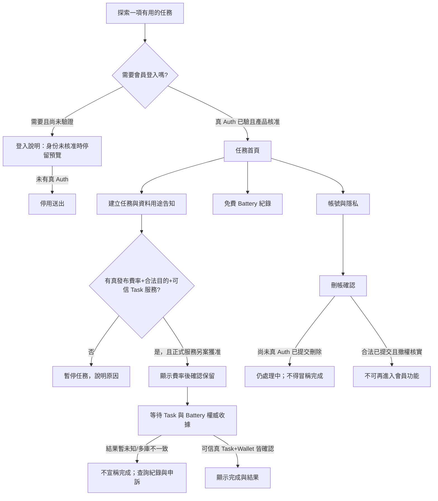

# AI-0｜Starry 首款消費 App「候選 A」體驗藍圖與上架前驗收 v0.1

> **2026-10-27｜候選產品紙面規格，不是首款 App 正式核准，也沒有開始 UI 程式開發。**
>
> GitHub 依據：[產品組合 Issue #125](https://github.com/starry-phd/id/issues/125)、[已驗規劃 Draft #130](https://github.com/starry-phd/id/pull/130)、[R18 AI-0 四組整合 Draft #131](https://github.com/starry-phd/id/pull/131) HEAD `f006e90311b3fecedae0f7c75004c940adfacede`、`docs/operations/future-starry-app-portfolio.v0.json`、`docs/release-readiness/release-readiness.v0.json`、`docs/requirements/AI0-R8-HIGH-PRIORITY-CONFLICTS-20261027.md`。
>
> R19 四位 Owner 依 Issue #2～#5 分頭做跨 SQLite 安全工程。**這份藍圖只有 AI-0 的 `docs/product/**` 與獨立 integration Gate；不碰 AI-1～4 程式、Expo routes 或真平台環境。**

## 1｜產品定位：不以技術模組假冒已驗證的消費商品

- **候選 A**：讓使用者完成「一件明確且有價值的 AI 任務」，了解過程、查看結果與其**永久免費**電池使用狀態。**任務種類/目標族群/實際效益尚未決定**。不是直接把 Starry ID 登入殼包裝成商店 App。
- **候選 B**：專題 AI 工具，保留作後續替代比較；沒有核定市場、產品名稱、正式 bundle/package、SKU、數字 X/Y 或定價。
- **AI-0 建議產品順序**：先證明「一件任務」可用、價值明確，再開發完整登入/任務/電池旅程；不可反過來因為 Auth/Billing/Battery 測試成功就推論消費者會使用。
- 正式商店 App 與中央 Starry ID 共用服務不同。現有 `apps/mobile/app.json` `starry-id-dev`、`phd.starry.id.dev` 都是 **DEV 測試殼識別，不能直接擅自改成正式 Store 識別**。
- Battery：首次合法註冊贈送 X／首次合法完成 AI 任務贈送 Y 的**方向**已定，值、費率/透支額度尚未核准；不可買賣、付費充值、兌換現金、用 Store 費用間接買免費電池。IAP/訂閱屬 AI-2 的**獨立付費權益**，首期不必預設加入。

## 2｜候選畫面資訊架構：12 個頁面，只是畫面規格

| 優先 | 畫面／代號 | 使用者看到什麼 | 必須阻擋的情形 |
|---|---|---|---|
| P0 | `DISCOVER` 探索 | 一項**待選定** AI 任務的作用與流程預覽 | 不自動索取會員資料，不展示假商店品牌 |
| P0 | `SIGN_IN` 登入說明 | 為什麼某功能需要登入的清楚解釋 | 未核准真 Apple/Google OAuth 前不能模擬已登入 |
| P0 | `HOME` 任務首頁 | 單一主要任務、入口與待確認的免費電池狀態 | 舊 Token、跨品牌/跨 App 非法存取 |
| P0 | `TASK_COMPOSE` 建立任務 | 必要輸入、隱私與資料用途、取消方式 | 未核准的敏感資料上傳或第三方服務調用 |
| P0 | `TASK_REVIEW` 確認任務 | 已核定當次免費電池費率與確定送出動作 | 費率、身份、合法目的或 Policy 不可驗證 |
| P0 | `TASK_STATUS` 任務狀態 | 排程中、未知、失敗、完成四種不混淆狀態 | 前端 timeout 或 retry 回應被誤認為完成 |
| P0 | `TASK_RESULT` 任務結果 | 真可信且與電池持久收據相符的結果 | Task 成功但錢包/Task 收據不一致，不能顯示成功 |
| P1 | `TASK_HISTORY` 任務紀錄 | 遮罩個資的狀態、日期、來源 | 與會員身份不一致或刪帳後原資料復活 |
| P0 | `BATTERY_LEDGER` 免費電池明細 | 餘額、保留中、撤銷、釋放、歷史 | 不得顯示「購買、儲值、兌現、到期」 |
| P0 | `ACCOUNT_SETTINGS` 帳號與隱私 | 帳號、權限、資料使用、刪帳及申訴入口 | 不得將 Starry 登入權限延伸成 H-Global 授權 |
| P0 | `DELETE_ACCOUNT` 刪除帳號 | 清楚後果、必要二次確認、處理狀態 | 尚未收到真 Auth committed delete 就顯示刪帳成功 |
| P0 | `HELP_APPEAL` 說明與申訴 | 可申訴誤扣、刪帳或失敗；公開入口最小化 | 不提供匿名讀取別人會員資料或事件明文 |

> 這 **12 個 Screen ID 不是現有 Expo 已完成頁面，也不是向 AI-4 額外派工**。是否全部落入首期 MVP，只有未來 G00 業主核准可決定。

## 3｜候選操作流程圖（只描述 UX，不暗示真實跨 D1 一致性）

## 4｜離線 UX 狀態與文案（系統未驗證，畫面就不能聲稱成功）

| 狀態 | 顯示給使用者的示意文字 | 可否顯示任務已完成／授權發電池 |
|---|---|---|
| `NOT_SIGNED_IN` | 此功能需要驗證會員身分，請先登入。 | 不可 |
| `AUTH_REVOKED` | 登入狀態已失效，請重新驗證。 | 不可 |
| `PRICE_UNAPPROVED` | 本次任務所需的免費電池數量尚未確認，暫時無法開始。 | 不可 |
| `POLICY_UNKNOWN` | 使用規則或資料權限尚未確認，請稍後再試。 | 不可 |
| `TASK_UNKNOWN` | 目前無法確認任務是否完成，請查看紀錄，避免重複提交。 | 不可 |
| `TASK_FAILED` | 任務未完成，請查看紀錄確認免費電池處理狀態。 | 不可 |
| `RECEIPT_MISMATCH` | 任務與電池紀錄尚未一致，已暫停確認，請聯絡支援。 | 不可 |
| `DELETION_PENDING` | 刪除要求尚在處理，完成狀態需以正式系統確認為準。 | 不可 |
| `ACCOUNT_DELETED` | 此帳號已無法使用。若有疑問，請透過申訴管道聯絡。 | 不可 |

**真正完成的狀態不是本 v0.1 UI blueprint 的預設值**：需 Auth/Task/Battery/Billing 及合法政策、跨 D1 方案與真後端個別已通過權威 Gate，才能設計正式完成訊號。目前所有選項都標示 `spec_only`，沒有任何真處理/扣款/付款/重新授權功能。

## 5｜可交給下一階段 App UI 的 P0 / P1 結果驗收（不是已有程式）

- **P0｜使用價值**：一個特定 AI 任務須先被業主選定，問題、目的、預期效果與輸入類型可清楚講解；無此決議，僅做假資料探索預覽。
- **P0｜身份、法律**：不強迫純公開預覽先註冊；僅會員功能才需正式 Session；資料用途/留存/申訴與刪除須合法且可操作；刪帳不能由客戶端預判成功。
- **P0｜可靠任務**：雙擊、超時、網路重試、任務提交但 Wallet 未完成、異步部分成功、一致性未知時全須 fail closed；用戶可看到「尚未確認」，不假扮成功。
- **P0｜免費 Battery**：在費率未核准時不顯示測試數字；不得付費購買或到期；對保留、結算與餘額顯示三種語意，從後端可信收據回讀；第一任務 Y 的防重給予不得繞過 Q119 法律 Gate。
- **P0｜商店與刪帳**：如所選 App 支援建立帳號，正式上架須重新核對當時 Apple/Google 帳號刪除、隱私/資料安全、真功能完整度與審核必要步驟；目前沒有官方 Store 審核、真 Data Safety 或 TestFlight/Play 測試證據。
- **P1｜歷史與通知**：需可讀螢幕閱讀器、明確的過期/部分成功提示；付費訂閱、推播/廣告/活動、HGlobal/第二波完整後台均不能因 UX blueprint 自動加入。

## 6｜Future acceptance cases（僅待工程核准後實作）

機器可讀 `starry-consumer-a-candidate.v0.json` 內列 **12 個 ACC-01～ACC-12**：從純預覽不蒐集個資、跨會員資料拒絕、Session 撤權、費率缺件禁止提交、雙擊、Task timeout、多 D1 收據缺失、合法目的、PITR 復活防護，到刪帳真提交、匿名申訴與永久免費 Battery 禁付費。對應的 `owner` 是**未來工程對接角色**，不是 R19 追加命令；每一個現況均為 `spec_only`，**不是已通過實際 UI/E2E**。

**無障礙/多語系候選**：按鈕和狀態有可朗讀標籤；顏色之外有文字提示；大字體不截斷刪帳風險；失敗時焦點可返回；任何「處理中」不能以倒數計時假裝完成。中文文案是示意，不代表已決定市場或正式語言。

## 7｜App 決策者需核准後才能移交給 AI-4

保留 [8 個仍待決的 APP-D01～APP-D08](https://github.com/starry-phd/id/issues/125)：第一款實際服務的使用場景/族群、名稱和商店識別/上架主體、是否首期訂閱/定價、Battery X/Y/費率、合法 Q104/Q119 資料保留與授權、ADR #87 跨 D1 A/B、真 Cloudflare/OIDC/Store/EAS/費用額度，以及第二款 App/Wave2 中央管理 UI 的立項。

**現在不要求使用者逐題回覆**。產品階段 F0/F2 只可做紙面/假資料、無費用規劃。AI-4 R19 正進行私有跨模組離線 Saga；不得因本文件建立 `apps/mobile` 的真 consumer routes、改 Dev app identity、啟用真 AI 模型/推播、EAS Build 或公開 Worker API。

## 8｜版本核對與封鎖

- `node docs/product/verify-consumer-a-candidate.mjs` 驗證候選畫面、法律/電池/存取限制、來源連結、真官方 Release JSON 11/11 BLOCKED，拒絕宣稱真商店、正式市場、付款或 R19 完成。
- `packages/integration/test/consumer-a-candidate-product.test.mjs` 只做 **spec schema + 安全負測**，不假冒 iOS/Android 真機驗收或外部 API/Cloudflare。
- GitHub 完整 Offline CI 要在新 AI-0 Draft 的 **實際 HEAD** 執行（不借 #131 綠燈）；成功也只稱 `UX_CANDIDATE_SPEC_VERIFIED`，不把候選 UI 設計「核准」或「已建置」。
- 正式 G00～G10 **11/11 BLOCKED**、`P05/PUBLISHABLE=false`、H-Global 暫停；不得合併 main、部署、動真 D1/R2/Queue/Secrets、Store/EAS、付款或產生費用。
