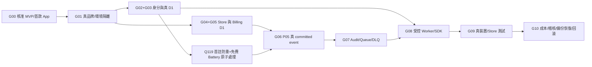

# AI-0｜R10 前置發布 Gate 證據缺口與人工決策佇列（2026-10-27）

> 本表是**待驗收證據清單（gap analysis）**，不是正式 Gate 狀態改寫。正式機器可讀的 `release-readiness.v0.json` 現為 G00～G10 全部 `blocked`、release authorization `granted=false`、auto deploy `false`。本文件不新增不存在的 URL、價格、商店 SKU、Cloudflare 資源或人工核准紀錄。
>
> 基準：AI-0 [R9 #76](https://github.com/starry-phd/id/pull/76) 固定 `e5a3ba76695316b3eaeb218fb0edd901d8820931`，最新同 HEAD 離線 GitHub Actions 3/3 success，並**不是**正式發布成功。[GitHub 交接及 SOP](../operations/AI-DEVELOPMENT-SOP-20261027.md)。

## 1. 11 個正式 Gate 的未解鎖證據

| Gate／Owner | 真實驗收時需要的證據（目前缺） | 可預先蒐集但不得冒稱通過的離線成果 | 是否需要額外權限／核准 |
| --- | --- | --- | --- |
| G00-SSOT／AI-0 | 核定首期 MVP、128 原始來源逐條保留/取代/延後、第一款實際上架 App | #65 128/128 heading 與 14 個高風險衝突裁決 **只是追溯，不是逐條功能核准** | 業主決定 scope |
| G01-ISOLATION／AI-0 | 真正 Starry 與 H-Global 的 Cloudflare/Auth/Store/D1/Secrets 資源 mapping、隔離測試與同意撤回流程 | Starry-only mock / brand-aware types 不能證明資源隔離 | 業主與平台管理權限 |
| G02-OIDC／AI-1 | 官方 Apple/Google sandbox/staging JWKS、PKCE/state/nonce、回調、真金鑰輪換與不相容身份拒絕 | AI-1 Auth safe ports、TS/SQLite 模擬負測 | 受控 OAuth 開發者配置／Secrets 核准 |
| G03-SESSION-D1／AI-1 | 真 D1 Member/Session、auth_version CAS、立即撤權、刪帳不復活／正式 migration rollback | AI-1 Session/Deletion/Reviewer offline tests | 受控 D1/staging／資料保護 |
| G04-STORE／AI-2 | 官方 Apple/Google 真 sandbox receipt、續訂、退款、換綁、replay、簽章/伺服器 API | AI-2 Store sandbox contracts；不可授付費權益 | Store 帳號／SKU／sandbox 專案 |
| G05-BILLING-D1／AI-2 | 已提交 Billing D1/outbox、真交易 first claim/CAS、退款排序/一致性、多 Worker 壓測 | R9 #75 D1-shaped reconciliation lease + metadata-only CAS | D1 有界測試／商店產品決策 |
| G06-P05／AI-0 | 唯一 P05 事件 schema、13 欄 scope、權威來源、版本兼容性與人工核准 | P05 candidate / AI-2 after-commit / AI-3 inbox 跨組模擬 | 業主／AI-0 正式 event contract |
| G07-AUDIT-QUEUE／AI-3 | 真 Queues/DLQ、ACK-after-commit、DLQ 耐久 receipt、審閱保留／遮罩／重播 | R9 #74 PITR/獨立備份「隔離 review」及內存 SQLite | Queues/DB/個資保留/事故授權 |
| G08-WORKER-SDK／AI-4 | 真受保護 Worker API、授權/限流、版本化 OpenAPI／SDK、受控 Staging/rollback | R9 #72 task settlement candidate、Wrangler dry-run | 安全 Secrets/Worker/域名 |
| G09-DEVICES／AI-4 | 真 iOS TestFlight、Google Play internal、Web E2E、Push/OAuth/IAP 實機驗收與額度 | Expo/mobile config 與 TypeScript CI | 第一款 App、Store 帳號、EAS 使用核准 |
| G10-OPS／AI-0 | 權限、成本上限、監控、稽核、合法刪除與申訴、獨立備份/PITR 恢復演練、事故與 rollback | CI/SOP #70 與 R9 mock 恢復 Gate 只提供測試入口 | 經核准的成本、存取及復原操作 |

### 重要差別
- 各 Gate 「required_evidence」是**完整條件**；已寫程式／CI success 並不等於真服務具備權威證據。
- R8 128 筆來源標題都能映射，但 `release-readiness.v0.json` 的 `requirements.reconciliation_complete=false` 屬正式未封存狀態，不能因這份規劃就改為 `true`。
- 檔內歷史 `baseline.ref=AI-0 draft PR #46` 為來源時間點，不是 R9/R10 已完成的證明；若未來更新該 JSON，需**另行證實所有正式 approval/evidence URL**，並保留歷史來源。

## 2. 缺件依賴圖與可行的安全前置準備



**現在可以做（不要求 Live Credentials）：**
- 離線整理真憑證最小權限清單、受控 staging/異常退款/刪帳/復原劇本與假資料 E2E 驗收項，待後續逐 Gate 核准。
- 明確 CI 需包含錯版、跨品牌、錯環境、stale Session、cancel-in-progress 最新 SHA、退款亂序／Store replay、Q119 身份指紋被刪除或保留期限屆滿時的合法 Gate、備份復活防護。
- 第二波 ADMIN-PREP P01–P10 僅收集 Starry-only 的 App/env/scopes/OpenAPI/admin/audit/monitoring/release evidence，**不新增後台 UI 或跨品牌管理權限**。

## 3. 只需準備、不要擅自決定的使用者選項

| 待決策項 | 尚缺資訊 | 沒決議時可安全繼續的事情 |
| --- | --- | --- |
| MVP 消費端產品 | 第一款 App、用途、bundle/package 識別、預定地區 | 完成 API／SDK 版本化與離線跨模組驗收；不得生成真 Store listing |
| Battery 產品規格 | 首註 X／首次成功任務 Y、task/App 費率、max debt 等**正式數值** | 保留後端版本化欄位和負測；`LIVE_BATTERY_WRITES_ENABLED=false` |
| IAP/訂閱與產品定價 | Apple/Play SKU、兌換邊界、退款/訂閱業務策略、首期付款市場 | 真 Store 尚未核准，可只完成 sandbox/mock 驗證；Battery 不與付費 SKU 互換 |
| Q104/Q119 隱私／跨品牌撤回 | 資料主體權利、合法去重 purpose/retention、刪帳/復權申訴 | 採 default-off、privacy gate fail-closed；不得啟動個資索引或真同步 |
| 真 Staging/Cost | 專用環境擁有人、受保護 D1、Secrets、EAS/Cloudflare/Store 配額和成本上限 | 分析需求及免費 CI、撰寫 rollback/checklist，**不產生付費** |
| 管理中心第二波 | 是否正式立項、Starry 後台域名、分期範圍及 UI 需求 | 僅完成 P01–P10 接口/權限預留，禁用 H-Global 管理服務 |

## 4. AI-0 每輪證據填寫規範

```text
Gate ID：
需要的真權威來源：
Owner／Reviewer：
依據的 owner-approved GitHub Issue URL：
單一驗收 PR + 最新 HEAD SHA：
成功的 Actions run URL（同 SHA）：
真 Cloudflare/OIDC/Store/Device/法律文件之權威證據 URL（沒有填 NONE）：
級別：DOCUMENTED / OFFLINE_TESTED / STAGING_VERIFIED / LIVE_VERIFIED
是否核准：NO / PENDING / YES（必須附權威核准 URL）
未知與風險：
```

**沒有證據時保持 `blocked`、填 `NONE`；不可把 PR CI、模擬 Store、mock 恢復、設定檔 green 或 GitHub 寫回視為 Gate 解鎖。**
