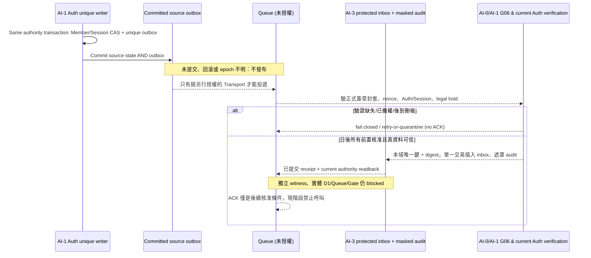

# AI-3 W1｜D87 單一寫入權威 × D06 分層 P05：會員撤權／刪除／稽核 commit-before-ACK 契約審閱

> 狀態：**W1 owner review candidate / not a final P05 schema / no actual Queue ACK / official G00–G10 blocked**。依 [AI-0 AI-3 W1 正式工作令](https://github.com/starry-phd/id/issues/4#issuecomment-6479255573) 和業主在本 AI-3 對話人工復工。**唯一 parent [#242](https://github.com/starry-phd/id/pull/242) exact `22d7ab1c127546e9e131810d58fdf7e0ccb17882`**，不修改 R008 / POST-R008 既有檔。已讀 [AI-0 #243](https://github.com/starry-phd/id/pull/243) 來源佇列、[#244](https://github.com/starry-phd/id/pull/244) 預設 OFF 本人唯讀 handler、[#245](https://github.com/starry-phd/id/pull/245) 五欄 client/server HMAC+SQLite 往返；它們是**不同子分支**，本 Owner 分支不改寫、繼承、重新實作、或將這些功能冒稱已接入部署 Worker。

## 1. 決議已核准的是「方向」，不是發版

- [D00](https://github.com/starry-phd/id/issues/1#issuecomment-6479057455)：會員/Auth/Session/權限與撤權先行；之後才處理 Billing、免費 Battery、通知等。並未核准重做 128 項、外部 App 或即時上線。
- [D87](https://github.com/starry-phd/id/issues/1#issuecomment-6478861308)：交易/事務**單一權威寫入者**，其本域同一交易包括 CAS、唯一約束、receipt/outbox；**不等於所有領域合一個實體 D1**，更不等於跨 D1 原子提交。
- [D06](https://github.com/starry-phd/id/issues/1#issuecomment-6478960617)：Layer 1 業務事件核心、Layer 2 私密安全投遞封套；**G06 沒列明的第 13 欄仍不能猜**，R006 17 欄 offline 候選不升格正式 schema。`version`≠`schema_version`、`issued_at`≠`occurred_at`。

## 2. 實際原始碼/SQL 審閱（固定 #242 Git Blob）
| Source @ Git Blob | 真正已有的邊界／發現 | 本輪契約缺口 |
|---|---|---|
| `src/queue-consumer.ts` @ `291d8758…` | `isBillingP05ForGate` 僅接受 **`billing.store_state_observed` 的 13 欄候選**，`createReliableBillingAuditConsumer` 在 `claimAndAppendAtomically` 返回 inserted / digest-equal duplicate 後產生 `ack_safe` **決策值**，但全靠注入的 AI0 validator、AI2 source/order port 和 AI3 store | **不能將 Billing 欄位格式當 D06 正式「第13欄」或當會員撤權的 P05**；不存在經核准的 AI1 current-session + sealed envelope live verifier |
| `src/queue-transport.ts` @ `f75d3d49…` | `dispatchQueueMessage` 會以 `ack_safe===true` 呼叫抽象 `msg.ack()`，對沒有 safe 證據、DLQ 未持久記錄的情況 retry | 這是未部署的 **port 驅動候選**，`ack_safe` 單一布林不證明真 committed Auth、inbox/D1、政策、獨立 witness；不得接線到 live |
| `src/d1-audit-adapter.ts` @ `b1c7b56f…` | `db.batch` 組合候選 Inbox + Audit claim，按 key + digest 分 `inserted`／`duplicate`／`conflict` | 可示範本地單 D1 原子性；**不是**跨 Auth／AI3 兩資料庫交易、真 D1 Durable receipt、Worker 權限或抗 PITR |
| `src/auth-deletion-battery-bridge.ts` @ `62e6035c…` | `VERIFIED_AUTH_OUTBOX_SQL` 以單一 Auth SELECT 重新核對刪帳 outbox/Member/Session、`lawfulDeletionRetentionApproved`；原始 AI1 event 僅 `event_id,s_user_id,occurred_at,event_type=account_deleted` | **這四個欄位不是** `identity.member.deleted` D06 11-core，也不具有簽章封套。不可僅 rename event_type、填假 `resource_id`／`auth_version` |
| `src/auth-deletion-battery-consumer.ts` @ `7d9c8d94…`＋`schema/0010…sql` @ `f50ded1a…` | AI3 local inbox trigger 原子撤銷 wallet/hold/journal；成功僅 `receipt_only`、`may_ack_queue:false`、`may_regrant:false`；宣告 Auth D1 為獨立來源 | D87 先要求 AI-0 定義來源域單寫入權威與目標域自己的寫入權；不能把 local Battery receipt 當 source commit 或 Queue ACK |
| `src/index.ts` @ `20a12af5…` | `revocationOrder` 對 stale 事件只標稽核；`erasureGate` 固定 policy_pending；`bindTrust` 由注入 AuthPort 判斷安全用途 | AI1 應是 Session/AuthVersion/Member 唯一寫入者；AI3 不可自行調整 Auth counter 或據客戶端 `verified` 派送 |
| `src/recovery-guard.ts` @ `8f840294…` | `assessIsolatedRestore` 要求 fence 交叉比對與外部 ports，`may_restore:false` | 沒有物理獨立、耐久 anti-PITR witness 真實驗證；恢復／replay 只能 blocked／review |
| `src/audit-retention.ts` @ `11cc434a…` | 既有 **Q115** 技術留存審閱邏輯寫到 ordinary 90天／important_management 1年，`AUTOMATED_AUDIT_PURGE_ENABLED=false` 且 `purge_permitted:false` | **不能把 Q115 的程式審閱時間直接外推為 Q104/Q119 已獲法務核准的刪除／撤權／合法保全期限**；W1 不變更既有天數、不新設其他期限 |
| AI1 `src/wave1-round008-auth-session-monotonic-cas.ts` @ `37565883…` | local SQLite CAS/issuer epoch/floor 僅離線候選，`verified_live=false` | AI1 必須提供經核准 current Member/Session/issuer 權威讀取 port；不能把 AI1 test mock 或 AI0 #245 本人唯讀 handler 當 Queue 事件簽章器 |

## 3. 單一來源寫入 → 目標本域 commit → 才能評估 ACK（概念序列）

**資料擁有權與兩種不同交易：** AI-1 只寫 Member/AuthVersion/SessionVersion/revocation 和自己的 source outbox；AI-3 只寫本域 inbox/去重/稽核與免費 Battery tombstone，AI-2 僅寫其 Billing receipt/outbox，AI-4 僅負責經審核後的 Worker/Queue 接線，AI-0 唯一審正式 P05 版與 Gate。同一 authority DB 的「狀態＋outbox」要一筆原子事務；另一域「inbox＋稽核」是**另一筆**事務，必須透過可靠可重送、idempotent 邊界串接；沒有跨域 COMMIT 承諾。AI-3 不新增 Auth writer、shared migration、Worker route 或真 D1。

## 4. D06 逐欄 Required／Conditional／Forbidden（**W1 整合審閱候選**，非正式 schema）
| 欄位層 | Required（審閱候選） | Conditional／server-only（審閱候選） | Forbidden／不得以來源資料取代驗證 |
|---|---|---|---|
| **Layer 1 業務核心** | `event_id`, `event_type`, `schema_version`, `brand_id`, `app_id`, `environment`, `occurred_at`, `correlation_id`, `resource_type`, `resource_id`, `result`（ADMIN-PREP 十一個既有名稱） | `idempotency_key`：重送、付款、Queue at-least-once 適用；`resource_id` 應為已准的最小 opaque ID | 真 session/token、Email/手機、地址、訊息全文、金鑰、付款卡、未授權 PII；不增第十三欄，不混同 `version`／`schema_version` |
| **Layer 2 私密封套** | 候選 `envelope_version, issuer_ref, kid, issuer_epoch, issued_at, expires_at, nonce, event_digest, integrity_signature` 及 event / brand / app / environment / correlation binding，僅信任的 Server issuer 可建立 | `current_auth_version, current_session_version, revocation_floor, trusted_actor_ref, trusted_member_ref, legal_policy_ref, erasure_hold_state, operator_approval_ref, outbox_commit_ref, inbox_commit_ref, recovery_witness_ref` 等**內部**證據，需經 AI0/AI1/法務逐項核准 | Client `verified:true`、原始 Session/OIDC/Refresh Token、Secret、私鑰、明文個資、付款資料；封套絕不等於前端可讀事件核心 |

**欄位語意：** 此表 Required 是「未來安全投遞介面審查應具備的候選類型」，不是已批准 wire names。實際 signature 算法、serialization、欄位型別、issuer/key rotation、epoch/nonce floor、KID、證據保存仍待 AI-0/AI-1 安全審查；本檔沒有簽章或傳輸實作。新增字段及事件種類不可自行視為正式 P05。每類事件的 per-event 定義見配套機讀 JSON。

| 事件 | D00階段 | 原寫入唯一 Owner | D06 Core的 conditional 與 Consumer審核 |
|---|---|---|---|
| `identity.session.revoked` | P0_MEMBER | AI-1 Auth SessionVersion/CAS authority | idempotency_key when transported/retried；invalidate_only; stale event -> audit_only; no notification on outdated session |
| `identity.member.deleted` | P0_MEMBER | AI-1 Auth committed deletion and outbox in source transaction | idempotency_key for at-least-once delivery；AI-3 local domain tombstone/receipt only; no regrant, no Queue ACK from current bridge |
| `privacy.erasure.requested` | P0_MEMBER | AI-1/member privacy authority; final owner/signature schema pending | idempotency_key on retry or async delivery；pending quarantine/barrier; not a real erasure command |
| `notification.delivery.queued` | LATER_DEPENDENCY | approved event origin owner; not a client | idempotency_key for Queue delivery/retries；fail closed; no live send, consumer Ack withheld |
| `billing.store_state_observed` | LATER_BILLING | AI-2 Billing provider-verified committed receipt/outbox | idempotency_key required for Queue/retries；current Billing-only queue-consumer is candidate, not cross-domain Auth P05 |

## 5. Failure/Replay/Recovery 狀態表（本期不授權任何實體 ACK）
| 狀態 | 來源事件／檢核結果 | 審閱 disposition | 禁止／後續 |
|---|---|---|---|
| `SOURCE_UNCOMMITTED` | missing/unknown committed writer and outbox | `retry_or_hold` | no enqueue/ACK |
| `AUTH_CAS_REVOKE_PENDING` | AI-1 current Auth/Session CAS not committed | `blocked` | no inferred revocation |
| `OUTBOX_COMMITTED` | unique writer committed domain event + outbox in single authority transaction | `review_only` | eligible for controlled delivery only after G06; no live send |
| `ENVELOPE_UNVERIFIED` | issuer/KID/signature/nonce/expiry/Auth epoch missing, untrusted, or replayed | `blocked` | no inbox claim or ACK |
| `AUTH_STALE_OR_REVOKED` | stale issuer/session/version, invalid actor, bad scope, or late revoke | `blocked` | no delivery/ACK/regrant |
| `LEGAL_UNKNOWN_OR_HOLD` | Q104/Q119 purpose/retention/erasure/hold undecided, on hold, or policy unavailable | `blocked` | no erase/replay/ACK |
| `DELIVERY_UNACKNOWLEDGED` | Queue has delivery but receiver has not committed durable inbox | `retry_or_hold` | never default auto-ACK |
| `INBOX_TRANSACTION_CRASH` | claim or audit insert errors before source-domain local commit | `retry` | transaction rollback; no ACK |
| `INBOX_COMMITTED_UNVERIFIED` | target D1 claims success but no durable readback/unique digest evidence | `retry_or_hold` | no ACK |
| `INBOX_COMMITTED_VERIFIED` | one target-domain transaction commits unique inbox+audit with exact payload digest | `review_only` | candidate ACK precondition only; G06/G07+independent witness not approved |
| `DUPLICATE_SAME_DIGEST` | identical scoped event_id/idempotency/digest with committed inbox and audit receipt | `review_only` | no second mutation; conditional ACK review only |
| `DUPLICATE_COMPETING_DIGEST` | same identity or nonce with different digest/issuer/source | `quarantine_required` | no ACK until separately approved durable quarantine and scope recheck |
| `QUARANTINE_PERSIST_FAILED` | invalid/competing event quarantine write failed | `retry_or_hold` | no ACK or silent loss |
| `DLQ_PERSIST_FAILED` | terminal attempt DLQ receipt not durable | `retry` | no ACK |
| `LATE_ERASURE_OR_REVOKE` | Auth/member revoke/erase after commit or enqueue before ACK | `blocked` | recheck current authority and quarantine; no send/ACK |
| `PITR_RESTORED_OLD_FLOOR` | backup restores old Auth/session/erasure floor or witness absent | `blocked` | no replay/restore/ACK |
| `WITNESS_NOT_INDEPENDENT` | same database or memory-only witness, no physical trust-domain attestation | `blocked` | cannot upgrade to live |
| `MANUAL_REPLAY_NOT_APPROVED` | human approval/legal scope/issuer verification not documented | `blocked` | no manual retry/Queue replay |
| `FINAL_ACK_REVIEW` | candidate committed source+target may satisfy conceptual ordering | `review_only` | live ACK requires separately approved real Gate evidence; never enabled here |

**唯一去重規則候選**：domain+app+environment+event_id+idempotency_key（當有）＋已驗 payload digest／簽章／issuer binding；同 digest、同 committed receipt 才可「不重複寫入」；同 key 不同 digest/nonce/issuer 或 restore 降低 floor 一律不當作 duplicate success。Ledger 未提交、late revoke/erase、lawful hold 未知、DLQ/隔離寫入失敗、PITR witness 不是物理獨立 ⇒ **不 ACK、不送通知、不恢復、不新增免費 Battery 權益**。

## 6. Q104／Q119 設計選項：**無法律年限的工程候選**
1. **先封鎖待法務批准**：目的、特定個資種類、撤權和投遞是否需保全、封存及刪除觸發、紀錄最小化都待 Owner/法務逐項簽核；不自行給出 30/90/365 天等新期限。
2. **最小化且獨立審批的稽核線索**：僅存遮罩後可證實行為/版本/結果之索引、留存權限由法務獨立決定；legal hold 期間防止未核准刪除。
3. **法遵核定後的 tombstone／不可復活 fence**：可設計 delete barrier、撤權 floor 與恢復拒絕；獨立 durable witness 尚未實證之前僅能 review，禁止真 PITR/replay。
以上是**可討論方案，不是三擇一業主決議**。既有 Q115 `audit-retention.ts` 的審閱期限不得當作 Q104/Q119 立法或已准自動清除；不改原檔。

## 7. 可整合的實際交付、Owner 與 Gate
- 本包只新增 **W1 自有 docs 的 Markdown + JSON，及一個針對核心/封套與既有 queue-transport 安全邊界的獨立負測**；新測試在本 W1 SHA 跑，不重跑 R008 作新的業務成果。AI-0 收件後以各 Owner **固定 Git blob SHA** 在獨立整合版審核；不能用 #245 另一個 SHA 的 green 冒充本版。
- **AI-1 #2** 需提供 current SessionVersion/AuthVersion、revocation、source committed event、issuer epoch/authority 具體正式 port，不將 AI-3 加為 Auth writer；**AI-0 #1** 需決定 D06 最終版本、G06 13 欄權威、不變的 release blocked 設計；**AI-4 #5** 後續正式 queue adapter 才能實測真正 commit-before-ACK。
- `independent_durable_witness_verified=false`、`legal_q104_q119_approved=false`、`formal_p05_schema_approved=false`，所有 `may_*live=false`；G00–G10 11/11 BLOCKED、`P05/PUBLISHABLE=false`、`release_authorization.granted=false`。**Battery 永久免費**，Ads OFF、Expo54 不變。
- 無 main merge、Preview/Staging/Production 部署、真 D1/Queue/Secrets/官方 OIDC/Store/EAS、付費資源、Cloudflare Preview 開啟；不介入 H-Global 或繁星回聲。Rollback 關閉此 Draft/棄本輪 3 新檔，#242 和 #243～#245、所有既有 Owner 原件不變。

