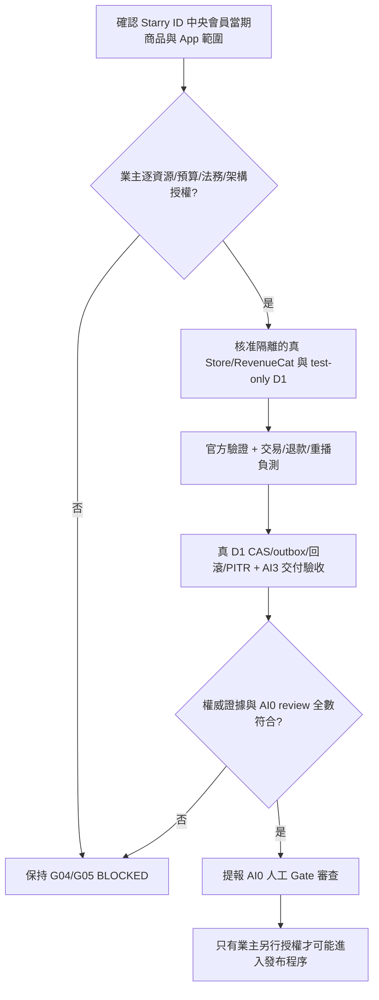

# AI-2｜R008 後 G04／G05 真實權威證據與分項核准清單

> **狀態：READ-ONLY EVIDENCE PREPARATION / APPROVAL PENDING / NOT A NEW ROUND OR RELEASE AUTHORIZATION**
>
> 本文件只處理 Starry ID 中央會員系統數位 Billing。外部 App（含繁星回聲）與 H-Global 全部排除。公開 GitHub 不寫帳號 ID、收據、支付 token、個資、秘密金鑰或帳單。

## 1. 目的：停止追加重複 synthetic tests，改為可驗證的 Gate 實證準備

**本次基準**：AI-0 GitHub [Issue #1 最新交接後工作令](https://github.com/starry-phd/id/issues/1#issuecomment-6477805792)、[Issue #220](https://github.com/starry-phd/id/issues/220)、[四 Owner R008 同版 Draft #234](https://github.com/starry-phd/id/pull/234)、[真平台差距稽核 #235](https://github.com/starry-phd/id/pull/235)、[P05 版本衝突 #236](https://github.com/starry-phd/id/pull/236)、[最新交接 #237](https://github.com/starry-phd/id/pull/237)。

已完成的 AI-2 [R008 owner #228](https://github.com/starry-phd/id/pull/228) 最終版本 **70b12ae7722ca7f9f4b3e975a5e43416a3ea2c5b**（三個原始 Git Blobs），已在 R008 四組 [#234](https://github.com/starry-phd/id/pull/234) **e47c068449b3aca37ddbf5d6d7f4255c2391a7c9** 以原件保留。**1,776 Node、413 SQLite :memory: PASS 只代表 Gate2 離線安全測試。** 本文件不修改、不重跑或重做上述任何程式。

### G04／G05 的正式發布定義（逐字沿用 release-readiness SSOT）

| Gate | release-readiness.v0.json 的原本 required_evidence | 目前 |
| --- | --- | --- |
| **G04-STORE** | Apple 官方 x5c PKI 信任鏈/核銷及 Google Play API/RTDN 驗簽/查詢；真實 sandbox 收據、退款、換綁、重播、原始交易所有權驗收 | **blocked / evidence=[] / verified_by=null** |
| **G05-BILLING-D1** | 真 D1 原子性、併發 first claim/entitlement CAS/outbox/read-after-commit；退款/延遲事件/重播安全與業主已核准商品/權益規則 | **blocked / evidence=[] / verified_by=null** |

**注意**：「G04／G05 有待核准清單」絕非「G04／G05 evidence 已交付」。真正 evidence 需官方平台／實體資料庫的已批准測試及具有可追溯來源的安全驗證；本文件不可直接填入正式 release Gate 的 evidence[]，也不更動其 release JSON。

## 2. G04｜官方商店與 RevenueCat：先批准什麼、再驗什麼

| ID | 業主／負責人需先核准（可分項拒絕或暫緩） | 未來可接受的真實驗收證據 |
| --- | --- | --- |
| G04-A01 | Starry ID 可接入商品、所屬 App、平台 SKU（非消耗型／月／年）、entitlement、brand/env 權威範圍 | 商品逐項核准 URL＋各平台 bundle/package/SKU 對應；**不得假定首款 App 已核准** |
| G04-A02 | Apple 官方測試方案、隔離 Sandbox 身分、Store Server JWS/x5c、Secret 保管與可能費用 | 正式信任根、證書鏈、簽章與交易／Bundle/SKU/環境核驗；退款／撤銷／重播／換綁真測試，去識別化證據 |
| G04-A03 | Google Play 隔離測試 App、Developer API service access 最小權限、RTDN 與配額／費用 | Google 官方 purchase token server-side 查詢及商品/訂閱／退款狀態；RTDN 是通知，不得單憑通知視為購買成功 |
| G04-A04 | RevenueCat 隔離專案、Webhook 真實驗證、App User ID 與 AI-1 current Auth 綁定規則 | 真 RC provider-verified 事件與跨會員／跨 App／OS 綁定拒絕測試；單一 RC 客戶端 status 不代表已驗 Store |
| G04-A05 | 獲准在匿名隔離 Sandbox 進行 replay／out-of-order／退款／續訂／換綁故障注入 | 原始交易 lineage／退款與重播/改綁因果順序的去識別化 traces；任何不可信來源均不得 grant |
| G04-A06 | Q104/Q119 隱私、支付留存、刪除與 legal hold 決策 | 正式法務批准 URL＋資料最小化／遮罩／保存與銷毀結果 |

**現況與拒絕門檻：** R007 所謂 Apple JWS／Google Developer API／RevenueCat webhook 只是 offline 的「claim label」，**沒有**官方 Apple x5c/JWS、Google purchase token server-side 驗證、真正 RC signature/App User ID 或真 Store 訂單。R008 雙來源看似一致仍不准發權，正式 G04 無任何外部成功證據。

## 3. G05｜真 D1 原子性、權益與資源批准表

| ID | 必須先核定／資源 | 真實驗收後才可附上的證據 |
| --- | --- | --- |
| G05-B01 | **#87 A** 單一 Starry 交易權威，或 **#87 B** durable outbox/saga；交易擁有權/補償策略須業主決定 | 跨 D1 不能假裝原子同一筆交易；失敗重試、回滾和資料責任邊界有正式架構審閱 URL |
| G05-B02 | Starry **隔離 test-only Billing D1／Queue／DLQ／Worker Access**：逐資源用途、權限、可回退/清理、可能計費和**費用上限** | 正式 test-only 資源與 bindings 的權限／用量／停用證據；**不得把現有 Cloudflare 的 echo-starry D1 當 Billing D1** |
| G05-B03 | 商品、會員與 App scope，月／年／買斷、退款／撤銷／restore／去廣告等權益政策 | 核准的 SKU→entitlement 矩陣、同會員及跨 OS 不會重複/錯誤發權的持久 CAS 驗收 |
| G05-B04 | 獲准執行真 D1 **first claim/transaction unique key/CAS/outbox/read-after-commit** 的故障注入 | 競爭交易只有一勝、outbox 原子提交與回滾、歷史重播不重授權、提交後讀仍一致的真 D1 traces |
| G05-B05 | Q104/Q119 與 AI-3 獨立 anti-PITR witness／退款撤銷復原策略 | 真實受控 PITR/延遲退款事件的復原否定驗收；原已撤銷權益不能因回復舊快照復活 |
| G05-B06 | **G06 P05 唯一正式規格/權威**及 Queue ACK-after-commit：事件核心 vs signed envelope 誰發行、誰接收 | 正式 schema 對照、版本/簽章、 durable outbox→AI-3 inbox→ACK 的故障證據；**G06 第 13 欄來源尚未列舉，不得猜測** |
| G05-B07 | ADMIN-PREP P03/P04/P06/P08：安全退款管理、step-up/審批人數、遮罩稽核、成本歸屬 | 高風險操作 scopes、冪等／審計、按服務/App/期間區分 estimated cost、provider billing、actual paid；不能開未核准超級管理 API |

**實際阻塞：** 真 Billing D1 未建立或未獲驗收；Starry Cloudflare 的 [#235 歷史只讀盤點](https://github.com/starry-phd/id/pull/235) 顯示 Workers 6、D1 1（echo-starry）、Queues 0，這只是 Starry 單一帳戶時間點資料，**不等於持續監控、Live Billing D1、真付款或獨立 anti-PITR 證明**。

## 4. 決策及驗收責任界線

1. **業主決策**：選定 Starry ID 中央會員涉及的當期商品/App/SKU 和帳號或商店測試方案；批准每個外部 Sandbox、D1/Queue/Worker、Secret/Access、設備/EAS、各種**費用上限**和 rollback；選定跨 D1 #87 A/B、Q104/Q119 法遵結果。沒有連結可證明已批准時一律 BLOCKED。
2. **AI-0／安全**：決定 P05 G06 13 未列舉 vs ADMIN-PREP 11 核心+條件 1 vs R006 offline 17 候選是否分層、誰有發權及跨系授權；正式 release Gate、是否可接真 platform。AI-2 不改 schema、不能以既有 synthetic HMAC 冒充 Apple／RC 簽章。
3. **AI-1**：current Auth Session、App/OS/會員身份與 RC App User ID 綁定。AI-3：撤權／退款／刪除／復原、durable outbox/anti-PITR、合法遮罩；AI-4：OpenAPI/Worker/SDK、隔離 Preview/Access、部署及 EAS 證據。
4. **AI-2（本 Owner）**：只在收到分項**明示核准**及真外部資源許可後，依正式版商品／驗權協議規劃實接測試。所有實體端點、Secret 和任何付費行為，必須在安全資源及審批鏈齊備後才可操作；目前交付僅為批准清單與未來可驗收測試步驟。

### 最小可判定流程（不執行）

## 5. 專責驗收與不得僭稱

此新文件配套的機器可讀快照： [POST-R008-G04-G05-AUTHORITY-APPROVAL-MATRIX.v1.json](./POST-R008-G04-G05-AUTHORITY-APPROVAL-MATRIX.v1.json)。JSON 中每個項目 `approval_required=true`，所有真資源 flag 與 release flag 都是 false，**沒有真付款、沒有真實帳戶識別、沒有外部 evidence URL**。這只是待批准資料索引，不是「官方已核准」或持續讀取平台的即時資料。

本 PR 只增加兩份 AI-2 **docs-only** 原件，無 TypeScript／Python／SQL 執行碼，**不新增重複 R009/模擬測試**。只能核驗 JSON 可解析、兩個正式 Gate 必備證據文字相同、所有旗標 OFF、兩個原件 blob SHA/基準差異；**若新 HEAD 未觸發 GitHub Actions，須註明 `NO_NEW_CI` 而不是借舊 #234/#236 成功當作自己 CI PASS**。此 PR 不更動 `docs/release-readiness/release-readiness.v0.json` 或任何官方 Gate/決策。

**Gate1 PARTIAL/BLOCKED；Gate2 R008 #234 四 Owner exact-SHA OFFLINE PASS（歷史且維持）；Gate3 G00–G10 11/11 BLOCKED；P05/PUBLISHABLE=false；release_authorization.granted=false；Ads OFF；Starry Battery 永久免費；Expo54 不更動。**

**回退**：關閉本獨立 Draft PR 並棄置新增兩個 AI-2 docs；#234、#235、#236、#237、#228、其他 Owner 原件、main、Cloudflare 已授權 Preview/Production auto-build OFF 狀態全部不變。禁止合併 main、部署、正式金流／訂閱帳號/D1/Queue、Secrets、開 Ads、增加付費資源、H-Global 或繁星回聲。
